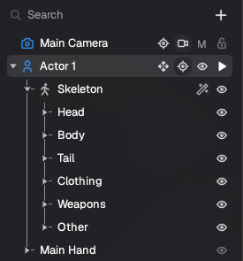
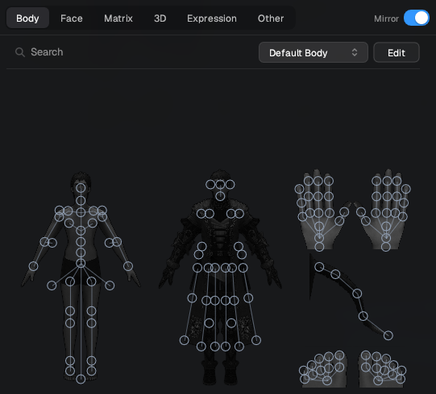
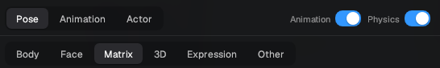
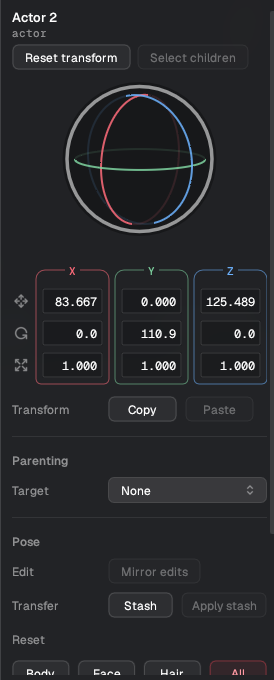
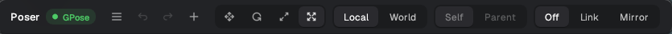

# Getting started

Poser is a plugin for posing actors and other things in a Final Fantasy XIV scene. It works while you're in GPose.

When you enter GPose, Poser opens its main window, along with a separate toolbar just below it. The toolbar is for changing things in the scene, such as moving or rotating them, while the main window is for selecting things and acting on them.

## The sidebar

On the left of the main window is the sidebar. It lists everything that's currently in your Poser scene, which at first is the main camera and your character.

When you select your character in the sidebar, the middle of the window changes to show information about it, starting on the **Pose** tab. A gizmo also appears on your character in the game view, so you can move or rotate the whole actor right away.

To pose a single bone, you first select it. There are two ways to do that.

**From the sidebar.** Click the arrow to the left of your character's name. The actor opens up to show its **Skeleton**, which is split into groups such as **Head**, **Body**, **Tail** and **Clothing**. Open a group to find a bone in it. The eye icon at the end of each row shows or hides those bones in the game view, so clicking the eye next to **Skeleton** draws every bone on your character, and you can click a bone there instead.

**From the Pose tab.** The **Body** page, in the middle of the main window, shows a map of the body, the hands, the feet and the tail, with a circle for each bone. Click a circle to select that bone, or drag a box around several circles to select them all. The **Face** page does the same for the face. **Matrix** and **3D** are two more ways to find a bone: as a grid of buttons, and as a skeleton you can turn around.

Whichever way you select a bone, the gizmo in the game view moves to it, and from then on it only changes that bone.

Above the list, **+** adds new things to the scene, such as more actors, props, lights and cameras, and **Library** opens your saved poses, scenes, MCDFs and objects.

## The middle of the window

The middle of the main window shows everything you can change on what you've selected. For an actor, it's split into three tabs, which you'll find along the top of the middle area:

- **Pose** is for the bones, and it's where Poser opens when you select an actor.
- **Animation** plays emotes and other animations on the actor.
- **Actor** changes the actor itself: its model, its colours, and the gear it has on.

The Pose tab is split again into pages, in a second row just below the tabs. Besides the four pages for finding bones described above, **Expression** holds the game's facial expressions and sliders for single parts of the face, and **Other** has the IK and gaze settings and the buttons to mirror or reset the pose.

To the right of the tabs are two switches. **Animation** pauses or resumes the selected actor's animation, which is handy when you want to pose on top of a frozen frame. **Physics** freezes physics, such as swaying hair and clothes, for the whole scene.

Lights, cameras, props and overlays don't have three tabs like an actor. When you select one of them, the middle of the window shows a single tab with that thing's own settings.

Above the tabs, at the very top of the main window, are three more buttons. The first one is named after what you have selected, so it reads **Actor** for an actor and **Light** for a light, and it brings you back to the tabs described above. **Environment** switches the middle of the window to the time of day, the weather and the lighting of the area you're in. **Scene** switches it to saving and loading your whole scene.

At the bottom of the Pose tab is a bar with the **Parenting** checkboxes. They decide whether the bones attached below a bone follow it when you change it. With **Pos** and **Rot** on, rotating a shoulder carries the arm and the hand along with it. Turn them off when you want to move one bone without touching the bones below it. **Clear selection**, on the same bar, deselects everything.

## The inspector

On the right of the main window is the inspector. It always shows the thing you've selected, whichever tab you're on in the middle of the window.

At the top is the name of what's selected, with what kind of thing it is written underneath. Below that, **Reset transform** undoes your changes to where an actor stands, which way it faces and how big it is. When a bone is selected, the button reads **Reset bone** instead and clears your edits on the selected bones, and **Select children** next to it selects every bone below that one.

The ball under those buttons is a small copy of the rotation gizmo. Drag its rings to rotate the selection, for example when the game view is too crowded to grab the gizmo there.

Under the ball are the exact values, in three columns for X, Y and Z. The first row is the position, the second the rotation and the third the scale. Drag a value sideways to change it, or double-click it to type a new one. With an actor selected, **Copy** and **Paste** below the values take all of them from one actor and put them on another.

Further down, the inspector repeats sections from the tabs that you'll want while posing, such as **Parenting** and the pose buttons, so you don't need to switch tabs for them.

## The toolbar

The toolbar is the separate bar just below the main window. Everything on it is about changing things in the scene, and it stays on screen even if you close the main window.

From left to right, it has:

- **The menu**, with shortcuts to the Library, the spawn menu, importing and exporting poses, saving the scene, reopening the main window, detaching the sidebar or the inspector, **Report an issue**, and the settings.
- **Undo and redo.** Ctrl+Z and Ctrl+Y do the same.
- **+**, which opens the same spawn menu as the **+** in the sidebar.
- **The gizmo tools**: move, rotate, scale, and all three at once. Poser starts on rotate.
- **Local** and **World**, which decide whether the gizmo's arrows and rings line up with the selected bone or with the world.
- **Self** and **Parent**, which decide whether a bone turns around its own joint or around the joint above it. They're greyed out until you select a bone.
- **Off**, **Link** and **Mirror**, which decide whether the matching bone on the other side of the body copies your edits. **Link** copies them as they are, and **Mirror** copies them mirrored, so raising the left arm also raises the right one.

## The window's own buttons

The buttons in the top-right corner of the main window pop the current tab out into a window of its own, open the settings, close the main window, and fold it up into its title bar. Closing the main window doesn't stop Poser: the toolbar stays, and its menu opens the main window again.

## Where to go next

- [Posing](posing.md) covers the gizmo, the Pose tab and groups in detail.
- [Animation](animation.md) covers playing and layering animations.
- [Scenes](scenes.md) covers saving and loading your work.
- [Basics](basics.md) covers undo, number fields and other things that work the same everywhere.
